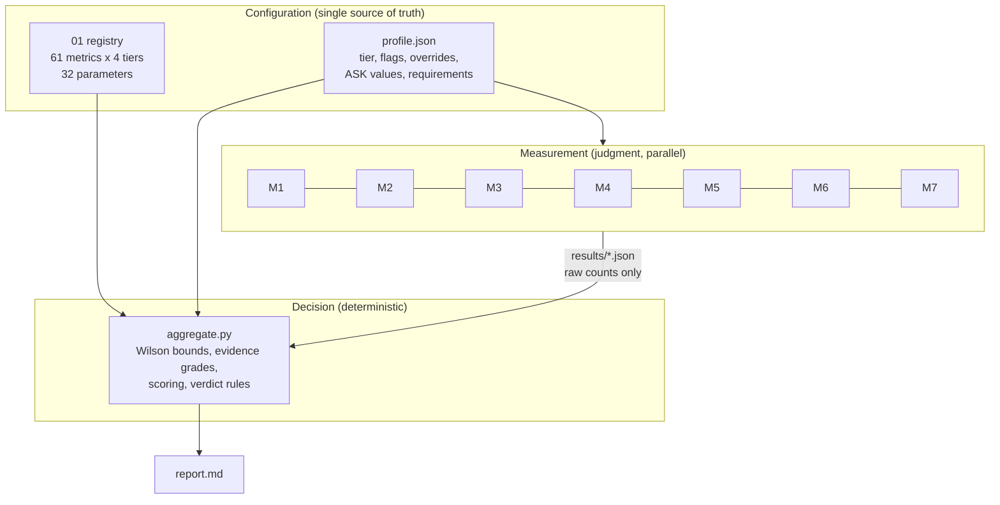

# Design

How the suite is built, why each part exists, and how the parts fit without overlap.

## Design goals

1. **One answer, reproducible.** The same evidence always gives the same verdict, whoever (or whichever agent) ran the tests.
2. **Production, not demo.** Every rule asks "would this still hold at real traffic, on real inputs, when something breaks?"
3. **Complete, without overlap.** Every production risk is owned by exactly one metric in exactly one module. No risk is counted twice, and none falls between modules.
4. **Configurable without forking.** Business-specific numbers are placeholders resolved at intake, not edits to the method.
5. **Parallel by default.** Modules can run at the same time with no shared state beyond the profile and the golden set.

## Architecture

The core design decision is **separating measurement from decision.** Measuring needs judgment: building test sets, running red-team attacks, breaking dependencies, reading traces. AI agents or people do that. Deciding needs consistency, so it is done by code. Agents report `k` and `n`, a value, or a pass/fail control result, plus an evidence grade. They are not allowed to write PASS. That one rule is what makes seven independent evaluators produce one uniform result.

### Contracts between components

| Contract | Defined in | Enforced by |
|---|---|---|
| Thresholds and parameters | `01` registry tables | `aggregate.py` parses them directly; `lint` rejects thresholds restated in module files |
| What each evaluator must produce | `09` result schema | `aggregate.py`; a missing metric counts as NOT_TESTED |
| Which metrics apply | profile flags + registry "Applies if" | `aggregate.py`; an evaluator's own N/A is converted to NOT_TESTED |
| Which module owns a metric | metric ID prefix + one `### ID` section | `lint`, run in CI |
| Verdict logic | `09` verdict rules | `aggregate.py`, covered by `selftest` |

## Module boundaries

Each module answers one question:

| Module | The question it answers |
|---|---|
| M1 | Is what comes out correct and usable? |
| M2 | Did retrieval supply the right context, and did the answer stay inside it? |
| M3 | Does the multi-step behaviour reach the goal safely and efficiently? |
| M4 | Can it be attacked or made to leak, harm or discriminate? |
| M5 | Does it keep working at real traffic and when dependencies fail? |
| M6 | Will anyone notice when it stops being true? |
| M7 | Is it worth running, and does it do what was asked? |

### Metrics that look alike but are not

These pairs are where overlap would normally creep in. Each one measures a different failure, and the playbooks state the boundary explicitly.

| Pair | Difference |
|---|---|
| OQ-02 hallucination vs RAG-05 faithfulness | OQ-02 asks whether a claim is **true**. RAG-05 asks whether it is **in the retrieved context**. An answer can be faithful to a wrong document, or true but ungrounded. Together they locate the fault. |
| OQ-01 accuracy vs DRF-04 concept drift vs DRF-05 version regression | OQ-01 is accuracy now on the golden set. DRF-04 is the **change** on fresh production labels (the world moved). DRF-05 is the **change** when the model version moves. |
| AGT-04 tool call errors vs OPS-03 system errors | AGT-04 counts errors the agent caused (bad arguments, wrong order). OPS-03 counts infrastructure failures (timeouts, 5xx, crashes). |
| AGT-09 unauthorized actions vs SAF-01 prompt injection | AGT-09: the agent oversteps on its own. SAF-01: an attacker makes it overstep. |
| AGT-06 loops vs OPS-05 cost | AGT-06 counts runaway runs. OPS-05 prices successful tasks and notes the worst-case runaway cost; it is not a second loop metric. |
| OPS-08 fail-loud vs DRF-08 synthetic probe | OPS-08: does the system **behave correctly** when a dependency fails? DRF-08: does anyone **find out**, from outside the app? |
| OPS-04 availability vs DRF-08 probe | OPS-04 is the uptime number. DRF-08 is whether the instrument producing it exists and alerts. |
| RAG-08 abstention vs SAF-06 over-refusal | RAG-08: "not in my documents" on questions the corpus cannot answer. SAF-06: safety or policy refusals of legitimate requests. |
| RAG-09 index freshness vs DRF-01 input drift | RAG-09: is the knowledge current? DRF-01: have the questions changed? |
| OPS-05 cost per task vs BIZ-05 cost vs human | OPS-05 is the technical unit cost. BIZ-05 compares the total (including human review and build) with the human baseline. |
| OQ-01 accuracy vs BIZ-02 human edit rate | OQ-01 is scored against references offline. BIZ-02 is what real reviewers changed in production. |

### Cross-module dependencies (deliberately minimal)

- M5's soak test (OPS-07) re-scores a sample with the M1 accuracy method, to catch quality that degrades under load.
- M7's BIZ-05 uses OPS-05 as an input.
- BIZ-07 is computed from the statuses of whichever metrics the requirements map to.

Each evaluator computes what it needs from the shared golden set, so all seven still run in parallel.

## Critical-scenario coverage

What breaks AI systems in production, and which metric catches it before launch and after it.

| Scenario | Caught before launch by | Caught in production by |
|---|---|---|
| Traffic spike, or peak sustained for hours | OPS-07 (load at headroom x peak, with quality checked under load), OPS-01, OPS-03 | OPS-04, DRF-07 alerts |
| Model provider down or slow | OPS-08 (each dependency broken), AGT-07 | DRF-08 probe, OPS-04 |
| Provider rate limits or quota exhausted | OPS-09 | OPS-06 retry rate, DRF-07 |
| Provider silently changes the model | DRF-05 (pinned versions, golden re-run) | DRF-03 output shift, DRF-04 |
| Missing or wrong config after a deploy | OPS-10 preflight | DRF-08 probe |
| Bad release | OPS-11 timed rollback, DRF-05 | DRF-03, DRF-07 |
| Silent degradation (looks healthy, does nothing) | OPS-08 | DRF-08 (outside, end-to-end, checks the answer and not just HTTP 200) |
| Prompt injection through a document, email or web page | SAF-01 indirect classes | SAF-01 on log samples, DRF-09 |
| Data leak across users or tenants | SAF-07, SAF-03 with canaries | SAF-03 scan on logs |
| Runaway agent burning budget | AGT-06, AGT-05 | OPS-05 worst case, DRF-07 |
| Duplicate side effects (double email, double charge) | AGT-10 | Idempotency keys plus audit log |
| Users ask about new things | RAG-08 abstention, OQ-08 robustness | DRF-01, DRF-02 |
| Knowledge goes stale, or deleted documents still retrieved | RAG-09 (including the deletion probe) | RAG-09 recurring |
| The world changes, so references go stale | (none possible before launch) | DRF-04 fresh labels, DRF-09 |
| Messy real inputs (typos, mixed language, long text) | OQ-08, GEN_EDGE_CASE_SHARE in the golden set | DRF-01 |
| Works technically but saves nothing | BIZ-01, BIZ-04, BIZ-05 | BIZ-02, BIZ-03 |
| Built the wrong thing | BIZ-07 requirements traceability | BIZ-03, DRF-09 |

## Guarding the evaluation itself

An evaluation can fail too. These are the ways it goes wrong, and the guard for each.

| Failure of the evaluation | Guard |
|---|---|
| Curated or tuned-on test set | Held-out split required. Representativeness and tail share recorded. Curated sets are E1. |
| Too few samples | `GEN_MIN_N`. Pass on the Wilson bound. Proven-zero sample sizes. Question count for claim-level metrics. |
| Biased or weak LLM judge | Kappa against human labels. Below `GEN_JUDGE_KAPPA_MIN` drops to E1. Cross-family judge advised. |
| Evaluator inflates a result | Agents cannot write PASS. The orchestrator spot-audits three results against their evidence files. |
| Evaluator hides a critical metric | Agents cannot mark N/A; only intake can, with a recorded reason. |
| Measuring a different config than production | `config_under_test` recorded and checked against the profile. Provider tier parity required. |
| Guessed business numbers | ASK values cannot be defaulted. M7 marks them NOT_TESTED instead of estimating. |
| A pass that silently expires | Re-evaluation triggers, and M6 required for PRODUCTION-READY. |
| The suite itself drifts out of shape | `lint` (one owner per metric, no restated thresholds, no unknown parameters) and `selftest` (verdict rules) run in CI. |

## Known limits

- **Coverage depends on inputs.** The suite tests the scenarios in the golden set, the task suite, the attack corpus and the requirements. A use case nobody listed is not tested. The design shortens the time from "a surprise in production" to "a permanent test case" (DRF-09 feeds failures back into the golden set), but it cannot test for scenarios nobody has imagined.
- **95% confidence is not certainty.** About one in twenty borderline passes would not hold with more data. Use the high or regulated tier where that matters.
- **Thresholds are starting points,** calibrated to common industry practice for each tier. Set them from your own risk appetite through overrides, and record why.
- **Compliance is out of scope.** The suite produces evidence a compliance review can use. It is not that review.
