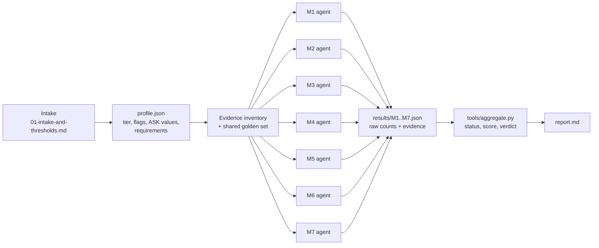

# AI Production Readiness Evaluation

A playbook suite and scoring tool that tells you, with evidence, whether an AI system is ready for production: an LLM app, a RAG pipeline, an agent, or an automation workflow with AI steps. You get one verdict and a report showing every criterion the system meets or misses, and why.

```
PRODUCTION-READY | CONDITIONAL | PILOT-ONLY | NOT READY
```

A review of an architecture that is not built yet gets a separate design verdict: `DESIGN-SOUND`, `DESIGN-GAPS` or `DESIGN-UNSOUND`.

## Why this exists

Most AI systems work in the demo. The demo uses hand-picked questions, one user, a warm cache and every dependency up. Production is different: real users phrase things badly, traffic spikes, the model provider rate-limits you or silently updates the model, a document carries a prompt injection, a database pauses, and a retry sends the same email twice.

Teams usually check a few of these and assume the rest. This suite checks all of them in a fixed order, with fixed pass lines, and refuses to call a system ready on evidence that would only convince someone in a demo:

- **A rate passes on its 95% confidence bound, not its average.** 91 correct out of 100 does not prove 90%.
- **Zero-tolerance means proven zero.** Claiming under 1% PII leakage needs 381 clean tests, not 20.
- **Every number carries an evidence grade,** from E0 (claimed) to E4 (weeks of production traffic). Critical metrics need pre-production evidence or better.
- **Production failure is tested on purpose:** sustained load with quality checked during the load, each dependency broken, config removed, rollback timed, and an outside probe hitting the live system.
- **Unknown is never a pass.** An untested critical metric caps the verdict at PILOT-ONLY.

## What it evaluates

61 metrics in 7 modules. Each metric is owned by exactly one module; CI checks this on every commit.

| Module | Covers | Example metrics |
|---|---|---|
| M1 Output quality | What the user or the next system receives | accuracy, hallucination, instruction following, schema validity, consistency, robustness to messy input |
| M2 RAG pipeline | Retrieval and grounding | hit rate, context precision and recall, faithfulness, citation accuracy, abstention, index freshness |
| M3 Agentic workflow | Multi-step and tool-using behaviour | task success by state check, tool accuracy, loops, recovery, escalation, permission boundaries, idempotency |
| M4 Safety and trust | Adversarial and data protection | direct and indirect prompt injection, jailbreaks, PII leakage, toxicity, fairness, tenant isolation, data residency |
| M5 Operations and production resilience | Surviving real traffic and failure | p95 latency, error rate, availability, cost per successful task, load and soak, dependency failure, rate limits, preflight, rollback |
| M6 Drift and observability | Staying good after launch | input, output and concept drift, model-version regression, trace completeness, alerting, synthetic probes, human review loop |
| M7 Business value and requirements fit | Worth running, does what was asked | automation rate, edit rate, satisfaction, time saved, cost vs human baseline, payback, every must-requirement met |

Modules that do not apply switch off from the profile flags. A system with no retrieval skips M2, and one with no tools skips M3.

## How it works



1. **Intake** asks a short list of questions: what the system is, which flags apply, a risk tier, the business numbers only you can give, and your requirements. Pick a tier (low, standard, high, regulated) and every threshold fills itself.
2. **Seven evaluators run in parallel,** one per module. They can be AI agents or people. Each follows its playbook and writes raw numbers plus evidence to a JSON file. Evaluators never decide pass or fail.
3. **`tools/aggregate.py` decides.** It applies the same statistical rules, evidence requirements and verdict logic every time, so the result does not depend on which agent ran which module.

See [DESIGN.md](DESIGN.md) for the architecture, the ownership boundaries between modules, and the critical-scenario coverage map.

## Quick start

Requirements: Python 3.9 or later. No packages to install.

```bash
git clone https://github.com/CAPP-Financials/ai-production-readiness-eval.git
cd ai-production-readiness-eval
python tools/aggregate.py selftest   # the scoring logic works
python tools/aggregate.py lint       # the suite is internally consistent
```

Then, for your own system:

```bash
mkdir -p evaluations/my-system-2026-11-21/results
cp templates/profile.json evaluations/my-system-2026-11-21/profile.json
# edit profile.json (see step 1 below), then:
python tools/aggregate.py check  evaluations/my-system-2026-11-21/profile.json
# run the modules (step 3), then:
python tools/aggregate.py report evaluations/my-system-2026-11-21/profile.json \
                                 evaluations/my-system-2026-11-21/results \
                                 evaluations/my-system-2026-11-21/report.md
```

## Where to do what

| Step | What you do | Where | Output |
|---|---|---|---|
| 1. Intake | Answer the intake questions, choose a risk tier, fill the ASK values and requirements | [playbooks/01-intake-and-thresholds.md](playbooks/01-intake-and-thresholds.md) | `profile.json` |
| 2. Check | Confirm no placeholder is left open | `python tools/aggregate.py check` | "profile complete" |
| 3. Prepare | List what evaluators can access; build the shared golden set, the human label set and a sandbox | [playbooks/00-orchestrator.md](playbooks/00-orchestrator.md), Phase 1 | `evidence-inventory.md`, golden set |
| 4. Evaluate | Run each applicable module, in parallel if you can | [playbooks/m1-...md](playbooks/) to [m7-...md](playbooks/) | `results/M1.json` ... `M7.json` |
| 5. Score | Generate the verdict and report | `python tools/aggregate.py report` | `report.md` |
| 6. Fix and re-run | Close the gaps the report lists, then re-run only those metrics | the report's "Evidence gaps" and "Findings" | a new report |
| 7. Keep it valid | Re-evaluate on the triggers in the orchestrator | [playbooks/00-orchestrator.md](playbooks/00-orchestrator.md) | dated reports |

The result file format each evaluator writes is in [playbooks/09-aggregation-and-report.md](playbooks/09-aggregation-and-report.md), and a blank one is in [templates/module-result.json](templates/module-result.json).

## Running it with an AI coding agent

Give the agent the orchestrator and let it dispatch one sub-agent per module:

```
Read playbooks/00-orchestrator.md and run an evaluation of <my system> at <repo / URL / staging>.
Start with intake: ask me the questions in playbooks/01-intake-and-thresholds.md, write
evaluations/<slug>-<date>/profile.json, and run `python tools/aggregate.py check` until it is complete.
Then dispatch one agent per applicable module with the brief in Phase 2, and generate the report.
```

The orchestrator contains the exact brief each module agent receives. It works the same run sequentially if your tool has no sub-agents.

## Adapting it

- **Thresholds:** every number lives in one file, [01-intake-and-thresholds.md](playbooks/01-intake-and-thresholds.md). Change a column to change a tier, or use `overrides` in one profile for one system. The tool reads that markdown table directly, so there is nothing else to keep in sync.
- **Criticality:** raise or lower a metric per system with `"overrides": {"SAF-05": {"criticality": "blocker", "reason": "..."}}`.
- **Out of scope:** only intake can rule a metric out, with `{"na": true, "reason": "..."}`. Evaluators cannot, so a critical check cannot quietly disappear.
- **New metrics:** add a row to the registry and a `### ID Name` section to exactly one module. `lint` fails until both exist.

## Example

[examples/acme-help-assistant/](examples/acme-help-assistant/) is a complete run on a fictional customer-support assistant with RAG and no tools. It scores 97.4 and still comes out **CONDITIONAL**, not PRODUCTION-READY. It had only 40 unanswerable test questions (too few to prove the abstention rate), not enough volume to prove the toxicity rate, and drift monitoring built but with no production history yet. That gap between a high score and "ready" is the point of the suite.

## What this cannot do

It reduces production risk; it cannot remove it. In particular:

- **It tests the use cases and scenarios you give it.** A situation nobody listed in the golden set, the task suite or the requirements will not be tested. The human review loop (DRF-09) and re-evaluation triggers exist to turn production surprises into new test cases quickly.
- **Statistics bound the risk, they do not eliminate it.** A PASS means the true rate is within target at 95% confidence on representative data.
- **Evidence has to be honest.** The tool cannot verify that a result file reflects a real test. The orchestrator spot-audits results against their evidence files, and you should too.
- **New attack techniques** appear faster than any fixed attack list. Refresh the M4 corpus regularly.
- **It is not a legal or regulatory sign-off.** The regulated tier is stricter, but EU AI Act, sector regulators and privacy law still need their own review.

## Repository layout

```
playbooks/
  00-orchestrator.md            entry point: principles, phases, agent brief, re-evaluation triggers
  01-intake-and-thresholds.md   intake questions + the single registry of all thresholds and parameters
  m1-...m7-*.md                 one playbook per evaluation module
  09-aggregation-and-report.md  result schema, evidence grades, scoring and verdict rules, report layout
tools/aggregate.py              scorer, report generator, profile check, suite lint, self-test (stdlib only)
templates/                      blank profile.json and module result
examples/acme-help-assistant/   a full fictional run with its generated report
DESIGN.md                       architecture, module boundaries, critical-scenario coverage, known limits
```

## License

MIT. See [LICENSE](LICENSE).
